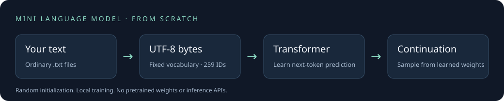

# MiniLanguageModel

[](https://github.com/patw1kkkk/MiniLanguageModel/actions/workflows/tests.yml)

**Train your own tiny GPT from scratch — using Python and PyTorch.**

A readable decoder-only Transformer you can train on ordinary text files.
No pretrained weights. No AI APIs. No cloud account. All learning happens locally.



> This is an educational next-token text generator with a terminal chat interface,
> not a general-purpose assistant. A GPT-style architecture does not imply
> ChatGPT-level capabilities. Early output will often be incoherent.

## Quick start

Use **64-bit Python 3.11 or 3.12** for the release's CI-tested installation path.
The code requires Python 3.11+ and PyTorch 2.6+; wheel availability for newer
Python versions and older hardware varies. See the [official PyTorch installer](https://pytorch.org/get-started/locally/)
if installation cannot find a compatible distribution. You do not need an IDE.

Clone this repository, or download and extract its ZIP from GitHub:

```sh
git clone https://github.com/patw1kkkk/MiniLanguageModel.git
cd MiniLanguageModel
```

**macOS / Linux**

```sh
python3 -m venv .venv
source .venv/bin/activate
python -m pip install --upgrade pip
python -m pip install -r requirements.txt
python main.py
```

**Windows (Command Prompt)**

```bat
py -3.12 -m venv .venv
.venv\Scripts\activate.bat
python -m pip install --upgrade pip
python -m pip install -r requirements.txt
python main.py
```

In PowerShell, you can use `.venv\Scripts\python.exe` directly instead of activating.
On Linux, your distribution may require installing its `python3-venv` package.
PyCharm users can select the same virtual environment and run `main.py`.

The included novel is detected automatically. Press **Enter** to train, or choose
**2** to explore without training. Training is never started silently. A complete
corpus epoch can take significant time on CPU; the progress display reports real
steps, loss, learning rate, and remaining time when calculable.

After successful training, the best validation state is saved and chat opens.
Type a sentence fragment to continue it. Use `/quit` to exit. Next launch loads
`models/transformer.pt`; unchanged data takes you straight to chat.

## What you can explore

- **Build a real GPT:** embeddings, explicit Q/K/V projections, causal attention,
  residual connections, feed-forward layers, and gradient-based optimization.
- **Train locally:** shuffled dataset-level epochs, bounded-memory disk-backed
  windows, held-out validation, early stopping, and best-state restoration.
- **Manage text simply:** add, change, or remove `.txt` files; startup explains
  the changes and offers continued training or a confirmed rebuild.
- **Inspect actual predictions:** byte probabilities, temperature, top-k/top-p,
  single-step generation, and attention heatmaps.
- **Resume safely:** weights, AdamW state, tokenizer, architecture, RNG, dataset
  provenance, and training metadata live in one atomically saved checkpoint.
- **Read the implementation:** all application code and tests are in `main.py`,
  with detailed English explanations of tensor shapes and the mathematics.

## Train your own AI

Place UTF-8 `.txt` files directly inside `training_data/`, then launch the app.
The normal trainer processes the entire current folder. Added files offer a new
corpus pass, including existing training documents. Removed or modified files
recommend a rebuild; continuing does **not** remove their influence from weights.
Identical document bytes are deduplicated before windowing and splitting.

```text
/data                      Inspect files and checkpoint provenance
/train --epochs 5          Up to five complete, shuffled corpus passes
/train --rebuild           Fresh weights; requires typing RESET
/trainstats                Actual training statistics
/save                      Save the active state
/quit                      Save pending state and exit
```

A rebuild resets weights, optimizer, and history. The previous on-disk checkpoint
is replaced only after successful training and serialization. Cancellation or a
failed save preserves it. There are no permanent backup collections; make your
own copy outside `models/` before a reset if you want to retain an older model.
Do not run multiple writers against the same model directory.

For an existing checkpoint with unknown training provenance or a different
segmentation policy, the corpus trainer refuses to claim independent validation.
The checkpoint still loads and generates normally. An explicit rebuild creates a
new compatible training state; nothing is reset automatically.

## Included demonstration dataset

The only bundled training text is **The Secret Garden** (1911) by **Frances
Hodgson Burnett**, the complete English plain-text edition of
[Project Gutenberg ebook 17396](https://www.gutenberg.org/ebooks/17396).
It is 462,012 bytes (about 451 KiB), includes its original redistribution notice
and full license, and is distributed unchanged. See [DATA_LICENSE.md](DATA_LICENSE.md)
for provenance, SHA-256, credits, and rights. The software's MIT license does not
apply to the novel. Historical language and attitudes may appear in generated text.

> This eBook is for the use of anyone anywhere in the United States and most
> other parts of the world at no cost and with almost no restrictions
> whatsoever. You may copy it, give it away or re-use it under the terms of the
> [Project Gutenberg™ License](https://www.gutenberg.org/policy/license.html)
> included with this eBook or online at www.gutenberg.org. If you are not located
> in the United States, you will have to check the laws of the country where you
> are located before using this eBook.

No reformatting is needed: the loader recognizes its **27 complete chapters**.
With the default split seed and context, the release edition produces **2,882
training windows and 565 validation windows**. All windows from a chapter stay
in one partition. Gutenberg front matter and the license are excluded from
learning, while remaining intact in the distributed file.

Other formats are supported:

- `<|endoftext|>` separates complete TinyStories-style stories and takes precedence.
- Two or more standalone `CHAPTER I` or `CHAPTER 1` headings activate chapter mode.
- Otherwise each file is a complete document. Provide several independent files;
  one unsectioned file cannot establish a held-out split.

Chapter detection is intentionally conservative: other heading conventions need
explicit story separators or separate files. If the deterministic hash split
produces an empty partition, the app asks for more documents rather than silently
splitting overlapping windows. Near-duplicates are not automatically detected.

## How it works

**Text files → UTF-8 bytes → shuffled windows → Transformer → cross-entropy → checkpoint → continuation**

The vocabulary has 256 byte IDs plus beginning, end, and padding markers. Finnish
and other UTF-8 text need no vocabulary expansion. A character can occupy several
bytes, so 128 tokens are **not** 128 words. Invalid generated UTF-8 is shown with
replacement characters; the sampler does not secretly repair model probabilities.

The default model has **842,880 trainable parameters**:

| Setting | Default |
|---|---:|
| Embedding width | 128 |
| Attention heads | 4 |
| Transformer blocks | 4 |
| Context | 128 bytes/special tokens |
| Feed-forward width | 512 |
| Dropout | 0.1 |
| Batch size | 16 |
| AdamW learning rate | 0.0003 |
| Warmup | 100 updates per corpus invocation |

Token and position embeddings feed pre-layer-normalized blocks. Attention uses
`softmax(QKᵀ / √d)` and a causal mask: a position cannot see future tokens. Each
block combines attention and a GELU feed-forward network through residual paths.
The final projection shares weights with the token embedding table.

Training predicts the next byte at every unpadded position. Cross-entropy measures
how much probability the model assigns to the correct targets; autograd computes
gradients, AdamW updates parameters, and gradient clipping limits their norm.
No ready-made GPT or `nn.Transformer` model is used. The optional fast attention
kernel uses the same explicit learned projections as the inspection path.

Decoder-only models predict continuations causally. Encoder-only models typically
read both directions; encoder-decoder models encode an input before decoding an
output. This project implements only the decoder-only architecture.

## Training and evaluation

The V4 corpus engine is the default `/train` path. Complete document content hashes
assign a deterministic 80/20 split **before** windows are generated. Each target
is covered once per epoch; the adjacent input overlap never crosses a document
or partition boundary. SQLite stores temporary windows and shuffle keys on disk,
so RAM does not grow with the corpus. Temporary disk space must accommodate the
encoded corpus and indexes; it can exceed the original file size.

Validation uses evaluation mode and no gradients. Epoch losses are weighted by
actual target counts. Patience defaults to 3, minimum improvement to 0.001, and
the lowest validation-loss state is restored with its optimizer and RNG state.
The reported work performed can exceed the restored checkpoint's step counter.

```text
/epochs 10
/corpus 3 0.001 cosine      Same corpus engine, configurable stopping and decay
/evaluate held_out.txt     Read-only evaluation of a separate file
/plot                      Export actual metric curves as SVG
```

The default schedule warms up then holds the learning rate constant; cosine decay
is optional. Each explicit invocation restarts its schedule and patience. Resuming
is from a committed epoch state, not an exact interrupted-batch continuation.
A failed corpus run rolls back; a process kill leaves the last committed file.
Training history contains numerical measurements, not a saved archive of text.

Perplexity is the exponential of mean negative log-likelihood. Evaluation labels
byte/EOS units and separately reports bits per byte. Word-level and byte-level
perplexities are not interchangeable. Chapter validation here measures unseen
parts of the **same book**, not independent-book or instruction-following quality.
Repeated tuning on the same validation data can overfit it; reserve separate test
data for final claims. Lower training loss alone is not evidence of improvement.

The legacy `/import` and `/train --legacy` tools remain for older experiments.
They repeat bounded batches and make no held-out claim. They are blocked on corpus
checkpoints to protect validation. Use `/train` for new work. `/autotrain` is off
by default and likewise cannot contaminate a corpus-trained model.

## Inspect and customize

| Command | Purpose |
|---|---|
| `/help` | Complete command reference |
| `/architecture`, `/stats` | Inspect settings and actual parameter count |
| `/predict The garden` | Raw and sampling probabilities for next bytes |
| `/debug on`, `/step The garden` | Inspect each sampled token |
| `/temperature 0.7` | Scale logits before softmax |
| `/topk 40`, `/topp 0.9` | Restrict the sampling distribution |
| `/max 100`, `/seed 42` | Bound generation and control its RNG |
| `/attention --layer 0 --head 0 The garden` | Actual attention SVG |
| `/learningrate 0.0003`, `/batchsize 16` | Adjust optimization settings |
| `/new tiny` | Explicitly reset to a smaller preset; confirmation required |
| `/device cpu`, `/device auto` | Select CPU or automatic MPS probing |

Attention weights are not a complete explanation of reasoning. Temperature and
sampling control variety, not factual correctness. Architecture changes apply to
new models and never silently resize or reset trained weights. Longer context
makes attention cost grow quadratically; larger models need more data and compute.

## Example terminal session

This is an **illustrative command sequence**, not a benchmark or fabricated model
response. Parameter counts and losses shown by your application are calculated.

```text
Choose [1]:              # Enter starts the first corpus epoch
... measured training and validation progress ...
Validated V4 state saved. Ready to chat.
YOU > The garden was
... sampled continuation; quality depends on training ...
YOU > /predict The garden
YOU > /train --epochs 5
YOU > /quit
```

The automated suite includes a real learning test that reduces loss and memorizes
a tiny repeated pattern. Memorization is a mechanics check, not a quality claim.
See [release validation](docs/VALIDATION.md) for the actual release checks.

## Hardware and limitations

CPU works on macOS, Windows, and Linux with a compatible PyTorch installation.
Supported Apple Silicon Macs automatically probe MPS forward/backward/optimizer
operations and use CPU if unavailable. Unsupported MPS operations are reported;
unsafe partial updates are not silently accepted. **CUDA/ROCm device selection is
not implemented in this release.** A GPU is not required.

Small models and small datasets often generate incoherent, repetitive, or biased
text. This is not instruction tuning, factual retrieval, a safety-trained chatbot,
or a commercial LLM. Repeated training can overfit; new corpora can cause forgetting.
Byte tokenization is easy to inspect but less efficient than learned subwords.
Checkpoints can memorize text: neither hashes nor learned weights guarantee privacy.
Only use text you have permission to process and redistribute.

## Project structure

```text
MiniLanguageModel/
├── main.py                 Application, educational explanations, and tests
├── README.md
├── LICENSE                 MIT for original software
├── DATA_LICENSE.md         Separate novel provenance and terms
├── CONTRIBUTING.md
├── requirements.txt
├── .github/workflows/tests.yml
├── assets/pipeline.svg
├── docs/VALIDATION.md
├── training_data/TheSecretGardenByFrancesHodgsonBurnett.txt
└── models/.gitkeep          Local transformer.pt is ignored
```

## Tests and contributing

```sh
python main.py --test
```

Tests create temporary models and data; they do not train or reset your real AI.
CPU CI runs on Linux, Windows, and macOS with Python 3.11/3.12. Contributions that
improve correctness, explanations, portability, or measured learning quality are
welcome. Start with [CONTRIBUTING.md](CONTRIBUTING.md).

Future work may explore better tokenization, efficient inference, and instruction
training, but these are not implemented or promised capabilities of v0.1.0.

## License and credits

Original software and documentation: [MIT](LICENSE), © 2026 patw1kkkk.
PyTorch is separately licensed by its contributors. The demonstration novel is
third-party material governed by its own provenance and redistribution terms:
[DATA_LICENSE.md](DATA_LICENSE.md). Project Gutenberg identifies the work as public
domain in the USA; check applicable local law elsewhere. This project has no
Project Gutenberg or OpenAI affiliation.
